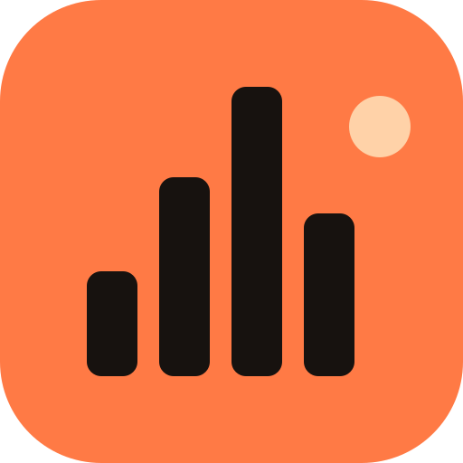
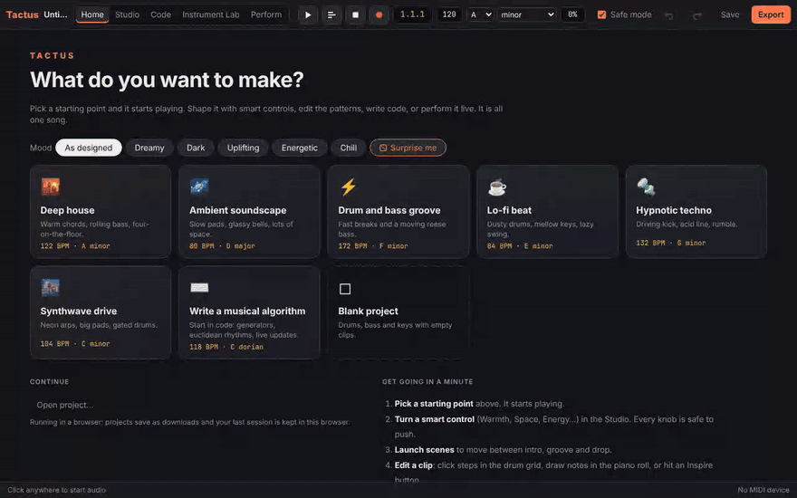
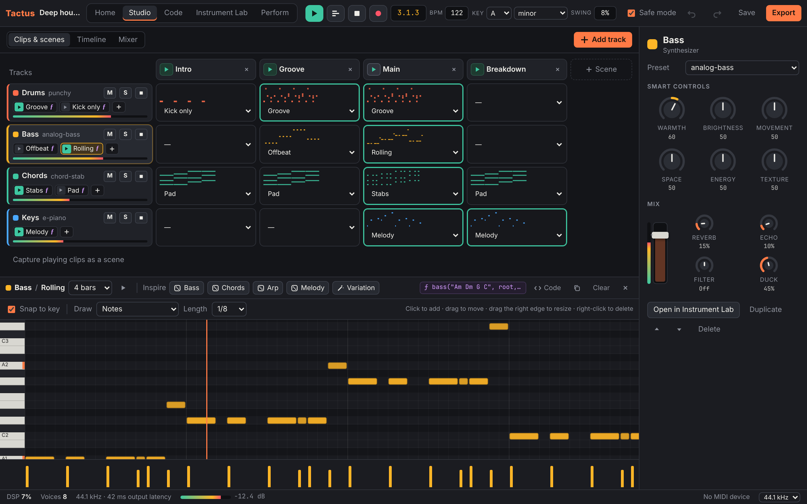
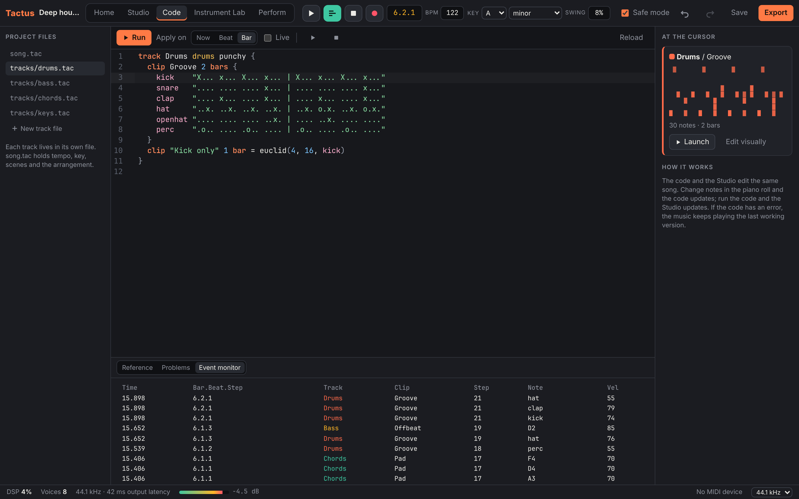
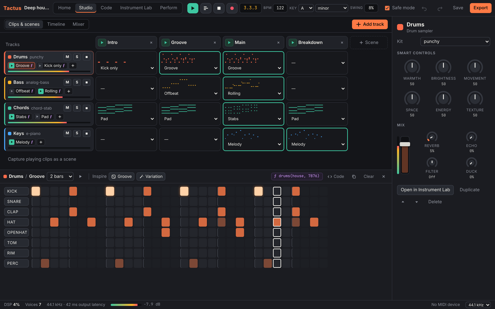
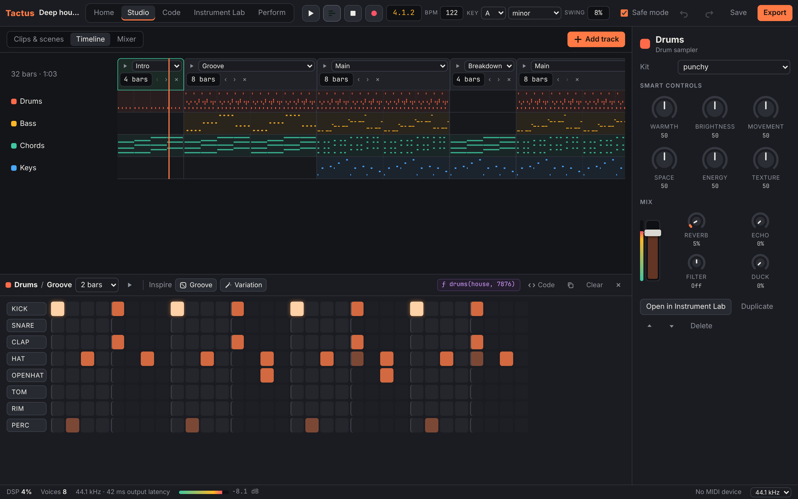
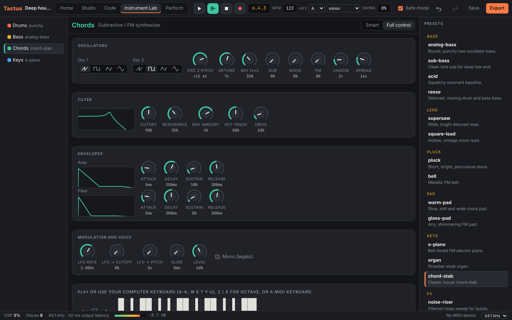
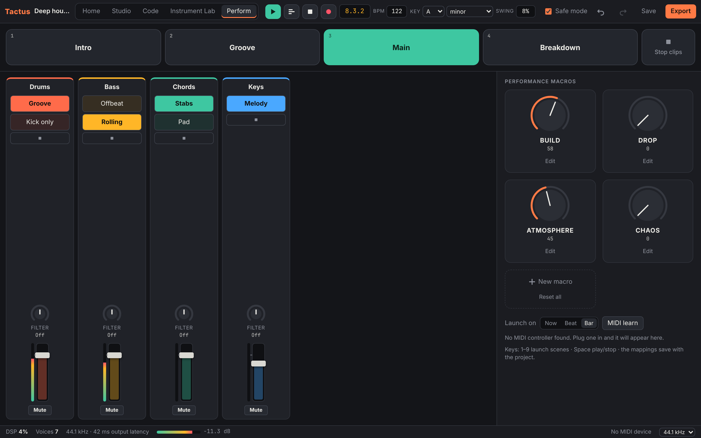
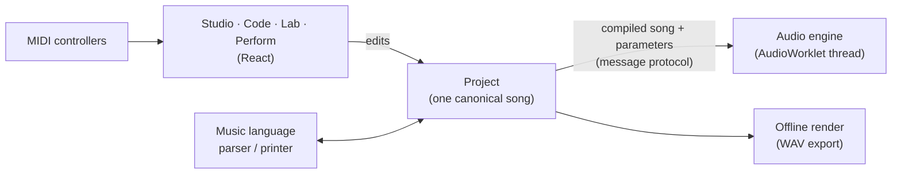

<div align="center">



# Tactus

**Make music with code, knobs and scenes. All live.**

An open-source music development environment: a studio, a live-coding language,<br/>a sound design lab and a performance view, all playing from one audio engine.

[](https://github.com/yeixio/Tactus/actions/workflows/build.yml)
[](LICENSE)


[](https://yeix.io/tactus/donate)
[](CONTRIBUTING.md)
[](https://github.com/yeixio/Tactus/issues?q=is%3Aopen+label%3A%22good+first+issue%22)

[**Download**](https://github.com/yeixio/Tactus/releases) · [Quick start](#quick-start) · [The language](docs/language.md) · [Architecture](docs/architecture.md) · [Contributing](CONTRIBUTING.md) · [Donate](https://yeix.io/tactus/donate)



</div>

## Why Tactus

DAWs treat music as audio and MIDI to arrange. Live-coding tools treat it as text. Tactus treats it as **one programmable song** that you can work on three ways, switching at any time without stopping the music:

| 🎛️ Discover | ⌨️ Develop | 🎤 Perform |
| --- | --- | --- |
| Pick a genre and a mood and it starts playing. Shape it with **smart controls** like Warmth, Space and Energy. Ask the **inspiration engine** for a groove, bassline or melody. | Every track is a small text file. Change it and press **Run**: the change lands on the next bar while the music keeps playing. A mistake never stops the music. | Big scene buttons, **performance macros** (Build, Drop, Atmosphere, Chaos), **MIDI learn** for any knob, and a record button that captures your set to WAV. |

## A quick tour

<table>
<tr>
<td width="50%"><br/><b>Studio.</b> Clips and scenes, a piano roll that knows your key, and smart controls for every track.</td>
<td width="50%"><br/><b>Code.</b> The same song as text. The event monitor shows which clip and step played each note.</td>
</tr>
<tr>
<td><br/><b>Step sequencer.</b> Paint drums, right-click for accents, and generate grooves that never overwrite your original.</td>
<td><br/><b>Timeline.</b> Arrange scenes into a song and play it from any section.</td>
</tr>
<tr>
<td><br/><b>Instrument Lab.</b> Smart controls up front, with the full synth (oscillators, FM, unison, filter, envelopes, LFO) behind them.</td>
<td><br/><b>Perform.</b> Launch scenes on the beat or bar, ride the faders and macros, and map it all to your controller.</td>
</tr>
</table>

## Features

- **Real-time engine on its own audio thread.** Sample-accurate scheduling, a subtractive and FM synth with unison, sub, noise, filter, two envelopes, LFO and glide, an 8-pad drum sampler with four factory kits, and drag-and-drop samples.
- **Effects and mixing.** Per-track drive, DJ filter, sidechain ducking, echo and reverb sends, plus a master ping-pong delay, reverb, glue compressor and limiter.
- **Live code that can't crash the set.** Runs apply on the next beat or bar. Errors are underlined in the editor while the last working version keeps playing.
- **Visual and code stay in sync.** Draw notes and the code updates. Edit the code and the Studio updates. Both edit the same song.
- **Musical guardrails.** Safe mode keeps sounds in pleasant ranges and snaps notes to the key. The piano roll draws in-key chords. A tip appears when your bass fights the kick. Turn safe mode off for full control.
- **Inspiration engine.** Generate drums, basslines, chords, arpeggios, melodies and variations. Each one is a reproducible code expression like `arp("Am F C G", up, 7)`, and your original clip is always kept.
- **MIDI.** Keyboards play the selected track, and MIDI learn maps knobs, faders, pads, scenes and clips. Mappings save with the project.
- **Projects are folders.** `project.json` plus readable `.tac` sources, ready for git. Autosave and undo/redo are built in.
- **Export.** WAV at 16 or 24-bit and 44.1 or 48 kHz, as the whole song or a scene loop, rendered offline by the same engine you hear.

## Quick start

**Download** a build for macOS, Windows or Linux from [Releases](https://github.com/yeixio/Tactus/releases), or from the artifacts of the latest [Build run](https://github.com/yeixio/Tactus/actions/workflows/build.yml). The macOS build isn't signed yet, so right-click the app and choose **Open** the first time.

**Or run it from source** (Node.js 20 or newer):

```bash
git clone https://github.com/yeixio/Tactus.git
cd Tactus
npm install
npm run dev      # desktop app with hot reload
npm run web      # or run it in your browser at http://localhost:5173
```

Then pick a starting point on the home screen and it starts playing.

## A taste of the language

```
tempo 122
key "A minor"

track Bass synth analog-bass {
  warmth 0.6                                   // smart controls, 0..1
  clip Line 1 bar {
    "A1 ~ . A1 C2 . E2 . | A1+E2 . . G1! . . . ."
  }
  clip Walk 4 bars = bass("Am F C G", walk, 7)  // a generator
}

track Drums drums punchy {
  clip Beat 1 bar {
    kick four-on-floor
    hat  "..x. ..x. ..X. ..xo"
  }
}

scene Groove { Drums: Beat, Bass: Line }
arrange { Groove 8 }
```

See the [language guide](docs/language.md) for everything else.

## How it works



The engine core is plain TypeScript with no browser dependencies, so the same code runs on the real-time audio thread, in the export worker and in the tests. It sits behind a small [message protocol](src/engine/protocol.ts), so a native engine (for example JUCE) can replace it later. The [architecture notes](docs/architecture.md) have more detail.

## Roadmap

Tactus is at **v0.1**: the core creative loop works end to end. Next up, roughly in order:

- [ ] Audio device and buffer-size picker
- [ ] Live looping and recording MIDI into clips
- [ ] Automation lanes
- [ ] MIDI clock in and out, Ableton Link, OSC
- [ ] More instruments: wavetable, granular and a multi-sample sampler
- [ ] Custom instruments and effects written in code
- [ ] Native engine (JUCE) behind the same protocol, then VST3 and CLAP hosting
- [ ] Extension SDK and a package format for presets, kits and templates

Have an idea? [Open a discussion](https://github.com/yeixio/Tactus/discussions) or pick up a [good first issue](https://github.com/yeixio/Tactus/issues?q=is%3Aopen+label%3A%22good+first+issue%22).

## Contributing

Contributions of every size are welcome: code, presets, drum kits, templates, docs, bug reports and music made with Tactus. Start with [CONTRIBUTING.md](CONTRIBUTING.md). It covers setup, the codebase map, and how to add a preset, a generator or a language feature.

Everyone taking part is expected to follow the [Code of Conduct](CODE_OF_CONDUCT.md). To report a security issue, see [SECURITY.md](SECURITY.md).

## Support Tactus

Tactus is free and open source, and always will be. [Donations](https://yeix.io/tactus/donate) (once or monthly, by card) fund its development: the native engine, more instruments, and the time to keep it all working on macOS, Windows and Linux.

[](https://yeix.io/tactus/donate)

## License

[MIT](LICENSE) © The Tactus contributors

The MIT license covers the code. The Tactus name and logo are not covered by it, so if you ship your own fork, please give it a different name.
