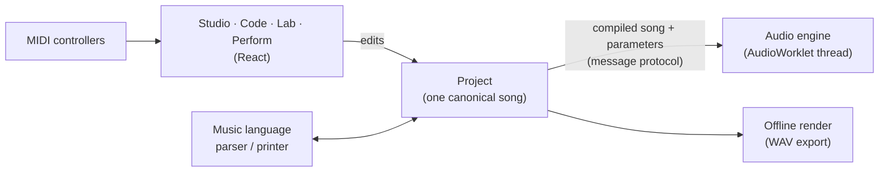

# Architecture

Tactus is built around one idea: there is exactly one song, and every view edits it.



## Source layout

```
src/model/     the canonical song (types.ts), presets, music theory, generators,
               smart-control mappings and macros (sound.ts), templates (project.ts)
src/dsl/       the music language: lexer, parser, builder (code -> song), printer (song -> code)
src/engine/    the audio engine core (pure TypeScript), its message protocol, the
               AudioWorklet wrapper, and offline rendering for export
src/audio/     the bridge between app state and the engine, and Web MIDI
src/state/     the zustand store, with undo/redo and autosave
src/ui/        React workspaces: Home, Studio, Code, Instrument Lab, Perform, Export
electron/      the desktop shell: file system, dialogs, MIDI permission
tests/         vitest tests for the engine, language, generators and projects
```

## The song model

`Project` in [`src/model/types.ts`](../src/model/types.ts) is the source of truth. It holds tracks, clips (notes on a 16th-step grid), scenes, the arrangement, smart-control values, performance macros, MIDI mappings and master settings.

- **Studio, Lab and Perform** change the project through actions in the store.
- **Code** prints the project as text with [`print.ts`](../src/dsl/print.ts) and parses text back into it with [`parser.ts`](../src/dsl/parser.ts) and [`build.ts`](../src/dsl/build.ts). Tracks and clips are matched by name, so their ids stay the same and the music doesn't restart when you run code.
- **Smart controls and macros** never change the stored synth settings. [`sound.ts`](../src/model/sound.ts) resolves them on top of the base sound each time parameters are sent to the engine, so turning Warmth back to its starting value gives you exactly the sound you started with.

## The engine

The engine core in [`src/engine/core/engine.ts`](../src/engine/core/engine.ts) is plain TypeScript with no browser APIs. The same code runs in three places:

1. on the real-time audio thread, inside an AudioWorklet ([`worklet.ts`](../src/engine/worklet.ts)),
2. in a worker for offline WAV export ([`render.ts`](../src/engine/render.ts), [`export.worker.ts`](../src/engine/export.worker.ts)),
3. in the tests.

It schedules notes with sample accuracy. Song changes, scene launches and clip launches are quantized to `now`, `beat` or `bar`. The UI thread never times notes.

Instruments are a polyBLEP synth (two oscillators, sub, noise, unison, FM, a state-variable filter, two envelopes, an LFO and glide) and an 8-pad drum sampler. The factory kits are synthesized at startup in [`samples.ts`](../src/engine/core/samples.ts), so the repository holds no audio files. Effects are per-track drive, DJ filter, sidechain duck and sends, then a master ping-pong delay, reverb (Freeverb), glue compressor and limiter.

## The message protocol

The UI talks to the engine only through messages defined in [`src/engine/protocol.ts`](../src/engine/protocol.ts):

- `song`: a compiled song (clips, scenes, arrangement), applied at a quantize point.
- `params`: resolved sound parameters for every track and the master.
- `sample`, `play`, `stop`, `launchScene`, `launchClip`, `noteOn`, `noteOff`, `preview`, `monitor`, `record`.

The engine replies with status (position, DSP load, voices), played events for the event monitor, and recorded audio.

Because the boundary is this small, a native engine (for example JUCE) can replace the TypeScript one later by implementing the same messages. That is also the path to VST3 and CLAP hosting.

## Project folders

A project saves as a folder that works well with git:

```
My Song.tactus/
  project.json     the song (source of truth, versioned schema)
  manifest.json
  src/             the song as code, one file per track (for reading and version control)
  samples/         audio files used by drum pads
  exports/
```

`project.json` carries a schema version, and `migrateProject` in [`src/model/project.ts`](../src/model/project.ts) upgrades older files.

## Known limits

- The audio engine is TypeScript on the Web Audio real-time thread rather than native C++. The operating system chooses the buffer size (typically 128 frames plus device latency), and there is no audio device picker yet.
- No plugin hosting (VST3 or CLAP), audio tracks or audio recording into clips.
- No MIDI clock, OSC or Ableton Link yet.
- Code comments are not kept when the Studio re-prints the code after a visual edit.
